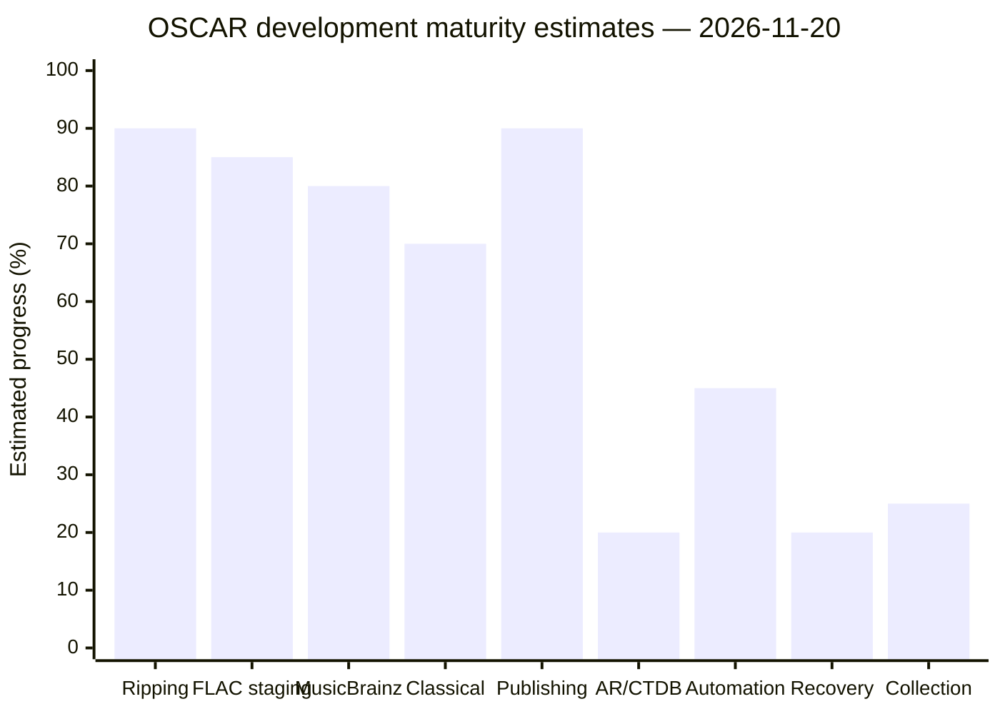

# OSCAR — Development progress dashboard

**Last assessed:** 2026-11-20  
**Assessment type:** qualitative estimates by the project team / ChatGPT, **not measured engineering KPIs**.  
**Canonical status and evidence:** [PROJECT_STATUS.md](PROJECT_STATUS.md)  
**Architecture:** [ARCHITECTURE.md](ARCHITECTURE.md)

> This dashboard tracks implementation maturity toward the eventual **insert CD → Go** experience. The percentages are subjective progress estimates, not test pass rates, promises or objective milestones. Passing CI does not mean a feature has been accepted on real Unraid hardware. Do not calculate a single overall project completion percentage from these different domains.

**Subsequent operator evidence (same date):** after explicitly clicking Apply, the OSCAR UI reports `1 recorded archive revision operation(s)` with status **`completed`**, source `/archive/Carmen Gomes Inc/Desire (2010) [fa89edc1]`, destination `/archive/Carmen Gomes Inc/[CGi2010] Desire (2010) [fa89edc1]`, and retained-original path `/archive/.oscar-archive-versions/3908eef79f114450b0a7eb76bec44926/f670468afcbb4c168adfdffae1df69bd`. Unraid file-manager screenshots show the renamed album directory, `ExtractionEvidence` and visible newly modified FLACs (first ten of twelve on screen). **This confirms user-visible completion and filesystem promotion, NOT yet independent verification of Vorbis `LABEL=CFMusic`/`CATALOGNUMBER=CGi2010` on all 12 tracks, `flac -t` integrity, retained original file digests, Collection SQLite linkage, restart persistence, or archive rescan.** Request independent `metaflac` / `flac -t` shell results before upgrading acceptance to fully verified.

**Unraid independent FLAC tag acceptance (2026-11-20, after completed archive revision):** operator ran `docker exec oscar python` using Mutagen on all twelve FLACs under `/archive/Carmen Gomes Inc/[CGi2010] Desire (2010) [fa89edc1]` and pasted full per-track results. **All 12/12** contain `CATALOGNUMBER=['CGi2010']`, `LABEL=['CFMusic']`, `MUSICBRAINZ_ALBUMID=['fa89edc1-32f9-4290-8788-bbac2e366a46']`, and `RECORDLABEL=[]`. This independently confirms the new published FLAC tags for all twelve tracks after the UI reported revision `completed`. **Now independently verified:** `flac -t` on all 12 new files (12/12 passed). **Still pending:** original retained-generation SHA-256/byte integrity, final Collection SQLite row/path and rerun-scanner suppression, restart persistence and interrupted-journal recovery. Do not call full end-to-end acceptance complete yet.

---

**Real Unraid post-migration audio acceptance (2026-11-20):** the operator ran `docker exec -i oscar python - <<'PY'` against the twelve new FLAC files in `/archive/Carmen Gomes Inc/[CGi2010] Desire (2010) [fa89edc1]`. The script invoked `flac -t --silent` independently on **all 12 files**, and every track returned `OK` (`Resultaat: 12/12 FLAC-bestanden geslaagd`). Combined with the earlier 12/12 Mutagen checks, the revised publication now has independently confirmed catalog `CGi2010`, label `CFMusic`, release ID and successful FLAC decoding for every track. **Not yet confirmed independently:** retained original version hashes/contents, Collection SQLite path and revision linkage, rerun scanner suppression, restart persistence or journal crash recovery. Do not state full end-to-end acceptance until appropriate checks complete.

---

**Real-Unraid retained-original integrity acceptance (2026-11-20):** the operator used a read-only Python SHA-256 check of each FLAC against the original archived `manifest.json` under `/archive/.oscar-archive-versions/3908eef79f114450b0a7eb76bec44926/f670468afcbb4c168adfdffae1df69bd`. **All twelve originals passed (12/12 SHA-256 matches)**. Together with independently confirmed 12/12 migrated FLAC tags and 12/12 successful `flac -t` checks, this verifies the engine's promised retained original audio-file bytes against publication evidence. Still outstanding for full end-to-end Unraid acceptance: Collection SQLite archive path/catalog link and two proposal `applied` statuses, post-migration scanner, restart persistence and recovery from interrupted journal. A retained-manifest self-hash or non-FLAC CUE/evidence reread has not been separately established by this test.

---

## Real-Unraid Carmen Gomes archive migration preview (2026-11-20)

The operator demonstrated a working read-only migration preview on live Unraid for the 12-track Carmen Gomes Inc. *Desire*: 2 approved changes, catalog number `CGi2010`, correct proposed archive folder rename and original publication ID `3908eef79f114450b0a7eb76bec44926`. **No apply or archive mutation occurred**. Actual generation promotion, retained original, `flac -t`, Collection transaction and crash recovery still require separate acceptance with backups and free-space checks. No maturity percentage increase for a preview alone.

---

## Carmen Gomes single-CD archive migration — live Unraid primary happy-path ACCEPTED (2026-11-20)

Operator supplied independent **read-only** SQLite queries against the running OSCAR container *after* the migration finished. Results:

- Exactly **one** `archive_items` row for MusicBrainz release `fa89edc1-32f9-4290-8788-bbac2e366a46`, with `archive_path=/archive/Carmen Gomes Inc/[CGi2010] Desire (2010) [fa89edc1]`, `catalog_number=CGi2010`, `label=CFMusic`, and `track_count=12`.
- Exactly two matched `metadata_proposals` rows: `CATALOGNUMBER` and `LABEL`, both **`status=applied`**, originating from `before_json=[]`, targeting `["CGi2010"]` and `["CFMusic"]`.
- Corresponding `archive_revision_operations` reports **`completed`**, the correct old/new paths and original retained generation `/archive/.oscar-archive-versions/3908eef79f114450b0a7eb76bec44926/f670468afcbb4c168adfdffae1df69bd`.
- From previous independent Unraid checks: all **12/12 new FLACs** contain the approved catalog/label and correct MusicBrainz release ID (Mutagen), **12/12 new FLACs** pass `flac -t`, and **12/12 retained original FLAC SHA-256s** match their original publication manifest.

**Acceptance judgment:** the normal **single-CD archive-revision apply, version retention, metadata write, audio decode, proposal state transition, and Collection SQLite rebind** are now validated on real Unraid. This is **not** proof of complete crash/restart resilience. Still pending: post-apply repeat whole-archive scan (no duplicate or stale proposals), container restart and persistence, interrupted-journal recovery under controlled failure, full non-FLAC CUE/evidence hash verification, and a separate boxset-safe migration (not implemented). No additional archive mutation is authorized or necessary for these read-only checks.

---

## Second real-Unraid archive revision recorded — Anastacia label-only, same destination (2026-11-20)

The operator's live **View archive revision history** now reports **2 completed operations**:

- **Anastacia — *Freak of Nature* (2001)**, MusicBrainz release prefix `4b370e6c`: `completed`, **source and destination intentionally identical**: `/archive/Anastacia/[504757 2] Freak of Nature (2001) [4b370e6c]`. This is a label-only metadata revision; `504757 2` was already the reviewed catalog number, so no album-directory rename is needed. Original generation retained according to journal at `/archive/.oscar-archive-versions/5ff97661e98742afbf5db690f827d0f1/f5e41eef584c44288cc76a2a8477e635`. Previously approved `LABEL` values were `Daylight` and `Epic`. **Evidence is operator-provided revision-history status only.** Independent new FLAC-tag checks, `flac -t`, original manifest SHA-256 checks, and Collection/proposal SQLite checks have **not yet been reported**; do not call Anastacia fully validated.
- **Carmen Gomes Inc. — *Desire* (2010)**: `completed`, original `/archive/Carmen Gomes Inc/Desire (2010) [fa89edc1]` → revised `/archive/Carmen Gomes Inc/[CGi2010] Desire (2010) [fa89edc1]`, retained original at `/archive/.oscar-archive-versions/3908eef79f114450b0a7eb76bec44926/f670468afcbb4c168adfdffae1df69bd`. This operation already passed independently verified 12/12 tags, decoder, original FLAC hash and SQLite/decision checks.

**Next:** collect the operator's read-only independent verification results for Anastacia (new FLAC labels `Daylight` and `Epic`, release UUID, `flac -t`, SHA-256 against retained original manifest, and Collection `label`, archive path, `applied` proposal); separately verify post-revision full-archive scan, restart persistence and failure recovery. Never migrate the Boulez 6CD with the current single-CD engine.

---

## Anastacia live-Unraid label-only archive revision verified; Collection label normalization (2026-11-20)

The operator independently verified the second successful single-CD revision, Anastacia *Freak of Nature* (2001): **12/12 new FLACs** have the reviewed `LABEL` values **Daylight** and **Epic** and the correct MusicBrainz release UUID; **12/12** pass `flac -t`; **12/12** retained originals match the original publication manifest SHA-256 checks. Read-only Collection query confirms the original album path (unchanged catalog `504757 2`), `track_count=12`, proposal `LABEL` status `applied`, but Collection's local `label` shows only `Epic` after UI Refresh: this is a **real catalog projection inconsistency**, not a FLAC retagging failure.

Root cause: `archive_revision._finalize` previously filled local `label` **only when blank**, retaining an older MusicBrainz-enriched source label `Epic` even after approved FLAC revision to `Daylight; Epic`. In PR #106 the finalization updates Collection labels from explicitly approved revisions **only if their existing provenance is known to be OSCAR/MusicBrainz-sourced or blank**, and records `archive_revision_approved_labels`; genuinely manual/unknown values remain untouched. UI wording changes from **Record label** to **Label**. Both refer to the release's record label; `RECORDLABEL` is treated as a legacy FLAC alias of canonical `LABEL`, **not** another distinct label entity. The existing Anastacia row can now be repaired through an explicit **Synchronize applied labels (Collection only)** action: it verifies the completed revision's FLAC hashes and exact approved label tags and changes only OSCAR/MusicBrainz-sourced local labels, preserving manual values. This feature has GitHub regression coverage but needs live Unraid acceptance.

Remaining operator requests: archive **Verify** (actual FLAC/manifest/CUE/source evidence, original-generation and Collection checks), operator-approved **Clean** and **Verify & Clean** to remove only explicitly verified retained generations with clear irreversible-loss warnings and strong journaling/race protection, plus **coordinated multi-disc** support for Boulez (discs 4 and 6 present, others absent). DO NOT silently delete `.oscar-archive-versions` or attempt single-disc apply to a boxset. Media servers may index hidden history; advise exclusions or separate archive mounts until cleanup is safely implemented. These are scoped follow-up engineering milestones, **not delivered in PR #106**.

---

## Verified archive revision maintenance: Verify / Clean / Verify & Clean (2026-11-20, PR #107 merged, CI green, Unraid acceptance pending)

An explicitly operator-triggered maintenance layer is being added to Collection's **Archive Metadata Migration** journal. Its safety boundaries are:

- **Verify** reopens the currently published and the retained original version, verifies exact manifest / publication lineage and original SHA-256 hashes, independently runs `flac -t` for ALL FLACs in BOTH generations, compares STREAMINFO decoded audio MD5, rechecks all approved metadata values, CUE/extraction evidence and every non-FLAC file, and validates the Collection row, catalog number, label provenance and proposal `applied` states. It does not intentionally modify archive files.
- **Clean** is an **irreversible** removal of *one* retained original publication directory selected by its exact **completed** journal operation ID; it NEVER deletes the current published album or the entire shared history tree. It requires `OSCAR_ENABLE_ARCHIVE_HISTORY_CLEANUP=1` as a separate explicit opt-in (OFF by default), the content-bound receipt from a successful Verify, double operator confirmation including declaration of a **tested external backup**, and a second, fresh full Verify inside the same archive-publisher lock. It journals `prepared` intent before deletion and `completed` after success. An interrupted cleanup must be inspected manually; there is no automatic destructive retry.
- **Verify & Clean** runs Verify and then offers the same explicit destructive confirmations; it does not silently delete on scan, archive apply, startup, import or ordinary Refresh.
- Clean deliberately sacrifices OSCAR's retained original evidence and built-in rollback capability. It breaks the ability to independently verify the historical parent publication from inside OSCAR after cleanup. **Exclude `.oscar-archive-versions` from Plex, Navidrome, Jellyfin etc. or mount only current published albums if possible; this is the safer default than deletion.** The OS/kernel and filesystem permissions must support safe symlink-aware removal.
- **Multidisc/boxset migrations remain deliberately blocked**. Do not use this single-CD Verify/Clean workflow as a substitute for a coordinated Boulez 6CD migration. Only physical discs 4 and 6 of 6 are known published on this system. A multidisc plan needs exact medium verification per disc, one release-level review, atomic promotion/recovery of all present discs, explicit policy for absent discs, and Collection synchronization.
- **Testing:** synthetic GitHub Python and Docker tests are necessary, not sufficient. Real Unraid Verify of Carmen Gomes and Anastacia is pending; opt-in cleanup must first be tested on a sacrificial test album with a restorable external backup before any consideration for these two genuine retained originals. No cleanup is requested, performed or approved by recording this design.

---

## Read-only coordinated label preview for incomplete multidisc releases (2026-11-20; PR #108 pending)

The next implementation adds `src/oscar/archive_revision_boxset.py` plus an authenticated Collection **Preview coordinated multidisc labels (read-only)** action. The operator selects any archived disc of the release in the existing Advanced Collection album selector. OSCAR verifies **all indexed/published leaves** under the same physical MusicBrainz release ID, each live FLAC manifest SHA-256 and Disc ID/CD medium/recording identity, exact current MusicBrainz release labels, and corresponding accepted per-disc label decisions. One group summary reports available and missing disc numbers, target label, each disc's tag status and approval fingerprint. Specifically, the operator's *Boulez Conducts Stravinsky* 6CD can show discs **4 and 6 present**, discs **1, 2, 3 and 5 missing**, with approved **Deutsche Grammophon** proposals on available discs if current metadata still agrees.

**No Apply exists in this preview.** `apply_supported: false` explicitly prevents accidentally running the single-CD migration on a boxset. **Next separate milestone**: design and test a durable, coordinated all-or-none multi-leaf apply/reconciliation journal with no invented data for missing media and full physical-CD/manifest provenance. Neither current boxset FLACs nor Collection labels are modified by preview. GitHub tests are not equivalent to a real Unraid boxset preview.

---

## Open-source beginner onboarding — draft only (2026-11-20)

Created an explicitly **unreviewed** commented Unraid/Portainer Compose example: [`compose.unraid.example.yml`](../compose.unraid.example.yml). It is a documentation baseline, **not** a tested/recommended replacement for the operator's existing working stack. Required next steps: review exact Docker/Portainer compatibility, network/access controls, mounting and permissions, drives, token handling, archive revision opt-in and safe defaults. **Planned:** [`docs/GETTING_STARTED.md`](GETTING_STARTED.md) (not yet written), a true beginner guide to Docker concepts, prerequisite checks, selecting bridge vs br0 networking, secure secrets, first rip, first archive publish, maintenance, updates and troubleshooting. See [PROJECT_STATUS.md](PROJECT_STATUS.md) for the full checklist. No maturity percentage increase for an untested documentation draft.

---

## Developer handoff and exact label handling (2026-11-20)

Added a dedicated [developer handoff](DEVELOPER_HANDOFF.md) for OSCAR chat 5, separate from chronological project status and progress scores: concise source map, verified status vs untested claims, 7 Unraid decision events, blockers, migration safety contracts and explicit next tasks. The latest operator report includes separate accepted Deutsche Grammophon labels on Boulez discs 4 and 6; these are **not applied archive changes**. PR #98 merged after GitHub Tests and Docker CI; its code addresses missing initial `LABEL` tags and `RECORDLABEL` alias detection; a safe coordinated boxset migration still remains future work. GitHub tests and Docker build succeeded; real Unraid verification of the new LABEL/RECORDLABEL behavior is still pending. No maturity percent increase.

---

## Operator-reviewed archive metadata revision (2026-11-20; PR #95 merged, Unraid acceptance pending)

PR #95 was merged into main after successful GitHub Python Tests and Docker build; it implements a separately enabled, **staging-independent** archive migration for one CD leaf at a time: preview all accepted proposals, explicitly confirm, create and verify a new tagged generation, preserve untouched original under hidden `.oscar-archive-versions`, update catalog-based folder naming and Collection SQLite row, and journal the transaction with an explicit recovery pathway. Applies only verified proposed values; `applied` history is distinct from approval. The bulk scanner now discovers published manifest paths directly rather than relying only on an indexed Collection row. Multidisc/boxset migration is blocked and remains a future milestone. Real Unraid validation and integration tests with actual FLACs remain necessary. No maturity percentage increase yet.

---

## Bulk archive scanner and Discogs PAT variable (2026-11-20)

PR #94 (merged after GitHub Tests and Docker CI) implements asynchronous **whole published archive** MusicBrainz scans with per-album progress/error isolation. One-album scans move to Advanced; the legacy Collection label-enrichment tool remains in Advanced because it serves a different read-only-external/write-local-Collection task. Discogs connection renamed to `OSCAR_DISCOGS_PAT`; Unraid Portainer environment must be updated at deployment. The MusicBrainz release UUID was already in FLAC `MUSICBRAINZ_ALBUMID`. No real-Unraid archive metadata migration has yet been performed; PR #95 added the opt-in implementation. Maturity estimates remain unchanged pending real Unraid acceptance.

---

## Unraid archive metadata decision history acceptance (2026-11-20)

The operator demonstrated five SQLite history events on Unraid: Carmen Gomes `CGi2010` accepted, CFMusic ignored → reopened → accepted, and Anastacia Daylight/Epic accepted. The review-decision history now has real-world acceptance evidence; same-value suppression after a rescan and restart persistence remain pending. A small UI fix hides **Reopen decision** on superseded historical entries and requires the actual current accepted/ignored status. No FLAC/manifest/Collection metadata migration is yet implemented. Qualitative progress percentages remain unchanged.

---

## Reversible archive decisions / catalog naming migration (2026-11-20)

Feature branch adds **Reopen decision** for the operator's accidentally ignored CFMusic label on Carmen Gomes Inc. *Desire*; old Ignore is retained as an immutable historical event and the exact proposal can be accepted after reopening. An accepted catalog number `CGi2010` is still **approval only**. Future archive metadata migration is explicitly required to update the album folder from `Desire (2010) [fa89edc1]` to `[CGi2010] Desire (2010) [fa89edc1]`, with verified safety/rollback and catalog path reconciliation. No file rename in this feature. CI + real Unraid acceptance pending; progress percentages unchanged.

---

## First real Unraid archive-scanner result (2026-11-20)

OSCAR's Collection UI displayed four selectable published leaves: Anastacia, Carmen Gomes Inc., and Boulez/Stravinsky discs 4/6 and 6/6. A Carmen Gomes scan found **2 differences** (missing `CGi2010` catalog number and `CFMusic` label); the **global pending queue showed 3 proposals**, including a previously observed Anastacia label addition (`Daylight`, `Epic`). This confirms archive scanning and pending-proposal display on real Unraid. It does **not** yet verify durable Accept/Ignore suppression after rescans or container restart, nor actual archive metadata application. Keep existing qualitative percentages unchanged.

---

## Archive metadata scanner — PR #89 merged, Unraid acceptance pending (2026-11-20)

Collection receives staging-independent read-only **Scan archive for metadata additions** and **Scan archive for metadata changes** plus persistent Accept/Ignore proposals and history. Validates published FLAC hashes, queries exact MusicBrainz CD medium and stores non-destructive proposals in `catalog.sqlite3`. Accept is approval for a separate future migration, **not an applied FLAC update**. GitHub Tests and Docker CI passed before merge (commit `f25e374`). No percentage increase before real Unraid acceptance. See [ARCHIVE_METADATA_LIFECYCLE.md](ARCHIVE_METADATA_LIFECYCLE.md).

---

## Archive-first metadata maintenance — design only (2026-11-20)

Future Collection actions: **Scan archive for metadata additions** and **Scan archive for metadata changes**, independent of temporary staging. Persist specific Accept/Ignore decisions; identical proposals stay suppressed, while genuinely new provider values or archive revisions can produce fresh proposals. Preserve immutable ripping evidence and archive history; only a separate audited, operator-approved archive-version migration may modify released metadata. See [ARCHIVE_METADATA_LIFECYCLE.md](ARCHIVE_METADATA_LIFECYCLE.md).

**No maturity-percentage increase:** implementation and real Unraid acceptance are still pending.

---

## Real Unraid acceptance — newly tagged staging copy (2026-11-20)

**PR #84 reprocessing accepted on operator's Unraid deployment:** newly generated Carmen Gomes Inc. *Desire* copy `cd2959e6cc2b4c4ab6fafb590808b2db` is `tagged_copy_ready_for_review`; inspecting actual FLAC tags and hashes gives `tags_match_preview` for all **12 tracks**. No archive publication occurred, and the original published archive is reported unchanged. This follows the confirmed read-only comparison detecting the corrected MusicBrainz catalog `CGi2010`. **Archival migration and Collection reconciliation are not implemented or verified yet.** Qualitative dashboard percentages remain unchanged until larger-sample validation.

---

## Collection catalog recovery and missing catalog warning (2026-11-20)

The operator observed `ARCHIVE_PUBLISHED · catalog: indexed` for *Carmen Gomes Inc. — Desire*, but Collection still reported three records and zero imports. The code fix accepts valid archive folders without a printed catalog prefix and confirms the SQLite row exists before reporting `indexed`. Additionally, future physical-CD archive reviews flag a missing MusicBrainz catalog number for explicit acknowledgment instead of silently omitting it. No numbers are invented, and existing audio, manifests and archive names are not changed.

**Validation status:** implementation on test branch; GitHub CI and real Unraid Collection re-import remain acceptance gates. Existing dashboard percentages remain unchanged.

---

## Latest engineering change — MusicBrainz match refresh (2026-11-20)

PR #79 merged to `main` after passing GitHub Tests and Docker build (commit `ca0239a`); Unraid acceptance for read-only refresh confirmed by operator on Carmen Gomes Inc. *Desire* job. Implemented: operator-triggered, authenticated read-only refresh of an accepted MusicBrainz release's current Disc ID medium association. The saved TOC, disc ID, and completed verification are checked before the network lookup. Historical `INFERRED_OPERATOR_ACCEPTED` is never upgraded, and no audio, tagging, or archive operation is triggered. See [MUSICBRAINZ_MATCH_REFRESH.md](MUSICBRAINZ_MATCH_REFRESH.md) and [PROJECT_STATUS.md](PROJECT_STATUS.md).

**The operator's Unraid GUI now confirms the saved Disc ID is attached on medium 1 of the accepted release, while preserving the original inferred-approval status.** Percentages remain unchanged because this validates one bounded feature, not fully automatic release certainty or independent pressing identification.

Branding foundation #78 is merged to main; image binary integration and Unraid visual acceptance remain outstanding.

---

## Current development — safe MusicBrainz metadata refresh / restaging (2026-11-20)

PR #84 has been merged to main after successful GitHub Tests and Docker build (commit `c5625a7`). The new implementation adds read-only comparison between fresh MusicBrainz metadata and the accepted prior tagged copy; after explicit operator confirmation it may create a new verified-copy staging job **without changing the already published archive or the original durable workflow**. The Carmen Gomes catalog correction has not yet been confirmed live on Unraid. All GitHub Tests + Docker build must pass before merge; user hardware acceptance follows. See [METADATA_REPROCESS.md](METADATA_REPROCESS.md) and [PROJECT_STATUS.md](PROJECT_STATUS.md).

**Maturity percentages remain unchanged** pending repeatable tests and operator-confirmed deployment. Archive replacement/migration is not part of this feature.

---

## Unraid acceptance — MusicBrainz catalog correction observed (2026-11-20)

The operator tested PR #84 against existing Carmen Gomes Inc. *Desire* and saw the current MusicBrainz release return catalog `CGi2010`, absent in the original saved metadata. OSCAR correctly displayed 14 changes: one album catalog field, one CFMusic label catalog field, and the 12 proposed CATALOGNUMBER track tags. **Read-only comparison accepted on real Unraid.** A separate newly tagged staging copy has **not** yet been reported verified, and archive/Collection migration remains future work. Do not inflate domain maturity percentages based on the preview alone.

---

## Progress by area

| Area | Progress | Visual progress | Evidence / remaining gaps |
|---|---:|---|---|
| CD ripping on Unraid | **90%** | `█████████░` | Multiple optical drives and successful physical rips; unattended detection and recovery remain |
| FLAC & staging verification | **85%** | `████████▌░` | FLAC decode, SHA-256, CUE and cyanrip evidence; independent verification is separate |
| MusicBrainz & release selection | **80%** | `████████░░` | Boulez multi-disc media 4/6 and 6/6 archived; operator-accepted single-CD missing Disc ID fallback and user-controlled MusicBrainz TOC attach handoff (#74–#76); fresh read-only Disc ID match refresh accepted on real Unraid Carmen Gomes job (#79); unattended edition certainty remains |
| Classical metadata | **70%** | `███████░░░` | Works, performers and multidisc review; further edge cases remain |
| Archive publishing | **90%** | `█████████░` | Anastacia and Boulez discs 4 and 6 independently published_verified in Collection and confirmed as separate folders inside same physical boxset on Unraid; recovery, additional releases and full audit remain |
| Independent AccurateRip / CTDB | **20%** | `██░░░░░░░░` | Cyanrip AccurateRip evidence is parsed; no independent full verification engine |
| Automatic end-to-end workflow | **45%** | `████▌░░░░░` | Three-mode Go! workflow with durable release acceptance, isolated tagged copies and human-approved archive publish demonstrated; still user-advanced, no automatic CD insertion/fully unattended orchestration |
| Recovery, resume & cleanup | **20%** | `██░░░░░░░░` | Delayed cleanup, crash recovery and safe resume remain major work |
| Local & multi-platform collection management | **25%** | `██▌░░░░░░░` | Local published-archive catalog, export, Discogs read-only PAK discovery in code; MusicBrainz OAuth and collection sync not yet implemented |

### Bar chart

This Mermaid chart uses the same baseline estimates as the table above (scale 0–100). The table is the accessible fallback when a GitHub client does not render Mermaid charts.

## How to update this living dashboard

1. **At every meaningful feature PR:** review impacted percentages, the supporting evidence and remaining gaps alongside [PROJECT_STATUS.md](PROJECT_STATUS.md). A PR should link both documents when it changes a roadmap domain.
2. Update **the table, text bars, Mermaid chart and date together**. If estimates do not change, explicitly record *reviewed, no percentage change* in the PR summary rather than raising numbers just because code merged.
3. Only count **Unraid hardware acceptance** when it was actually completed; differentiate *implemented*, *CI passed*, *Docker image built*, *hardware tested* and *operationally proven*.
4. Require a brief explanation when an estimate changes (new verified behavior, reduced risk, regression or changed scope). Percentages may go **down** when new gaps are discovered.
5. Do not treat this as an automatic performance gauge. Until metrics are instrumented, **values are editorial judgments**, maintained with code/documentation changes rather than dynamically derived from CI.
6. Never confuse a successful `flac -t` or a cyanrip log claim with an **independent AccurateRip/CTDB verification**.

## Assessment log

| Date | Change | Evidence |
|---|---|---|
| 2026-11-20 | Reassessed MusicBrainz 75 → 80, archive 85 → 90, Go! automation 30 → 45; added separate collection-management 25. These are **subjective** domain maturity estimates, not completion or CI coverage. | Real Unraid: Boulez CD 4 and CD 6 both `published_verified`, separate `Disc 04`/`Disc 06` folders under one boxset; Disc ID of Carmen Gomes *Desire* attached to MusicBrainz via human-confirmed handoff; #74–#76 merged/tested. MusicBrainz OAuth, automated insertion, error recovery still not built. |

| Date | Change | Evidence |
|---|---|---|
| 2026-11-19 | Reassessed after PR #58 configuration UI (Best Guess / three Secure review levels); no percentage change because execution policies and unattended orchestration remain future work. | Settings migration/validation tests and [PROJECT_STATUS.md](PROJECT_STATUS.md) |
| 2026-11-19 | Reassessed after risk-based physical edition candidate UI; percentages unchanged pending Unraid testing and server-enforced approval evidence. | Unique candidates inspected read-only; ambiguous candidates prompt for catalog; see [PROJECT_STATUS.md](PROJECT_STATUS.md) |
| 2026-11-19 | Reassessed; no percentage change. PR #52's archive-audit CLI ran on real Unraid: 1 album, 12 FLACs, PASS_WITH_WARNINGS (expected EVIDENCE_NOT_EMBEDDED). Source-evidence embedding from PR #51 and independent CTDB are still untested. | User's terminal output of `docker exec oscar python -m oscar.archive_audit /archive`; [PROJECT_STATUS.md](PROJECT_STATUS.md) |
| 2026-11-19 | Initial baseline: 90 / 85 / 75 / 70 / 85 / 20 / 30 / 20 | Physical multi-drive tests, verified Anastacia archive publishing (PR #50), source evidence preservation (PR #51, CI-tested), read-only archive auditor (PR #52, CI-tested), documented in [PROJECT_STATUS.md](PROJECT_STATUS.md) |

## Soloist metadata classification correction — PR #65

Real OSCAR Collection Library feedback exposed broad session performers incorrectly classified as soloists on pop albums. Fixed by preserving full source performer credits and limiting classical soloist display to explicitly tagged classical albums with soloist-marked contributor roles. Re-import can repair old automatically derived fields without changing archives. No change to Go controller or project progress percentages.

## Go! executable phase one — PR #64

Automatic durable job creation at rip start, verification callback and read-only release candidate discovery have been added with a single Go! interface. No automatic tagged-copy or final archive publication yet. **Keep the maturity estimates unchanged** pending GitHub checks, real Unraid physical acceptance and end-to-end safe tagged-copy/publish orchestration. Next priority: verified release resolver and explicit policy enforcement.

## Persistent workflow ledger toward Go! (PR #63)

A durable per-rip phase/event ledger with user mode snapshot and safe review deferral has been implemented as a **manually registered foundation**. It is not yet an automatic scheduler, and cannot restart an interrupted rip or auto-tag/archive. Maintain the eight qualitative percentages pending real Unraid acceptance and an executing state machine.

## Track-level collection evidence + Go! roadmap (PR #62)

Source-backed track/credit/Work indexes and a strictly exact-release+catalog MusicBrainz label-backfill action have been added to the collection workflow. **No completion-percentage increase yet:** CI and actual Unraid verification are separate; a persistent per-disc controller and safe metadata decision engine are not implemented. The next development priority is [AUTOMATION_ROADMAP.md](AUTOMATION_ROADMAP.md), not continued collection UI polish.

## Nextcloud-compatible exports and classical album discovery (PR #61)

Adds XLSX download plus read-only album-level search/sort by label and classical performers; safe in-place SQLite migration, and explicit label evidence recorded in *future* publication manifests. Track-level classical Work/Soloist tables, independent backfill of old label metadata and remote Discogs collection writes are still missing. Do **not** inflate existing percentages until CI, actual Unraid import and Nextcloud editor checks.

## Phase 1 collection catalog progress (PR #60)

Local database of OSCAR published archives, ODS/CSV export, sortable UI, read-only Discogs PAK identity/folder access and fixed metadata rip attribution are implemented in code. These do not yet provide a comprehensive physical ownership database, remote collection write, edition matching or automatic workflow. Keep all existing qualitative percentages unchanged pending CI and real Unraid acceptance.

## Proposed collection management extension

[Discogs and OSCAR local catalog design](DISCOGS_COLLECTION_CATALOG.md) covers secondary physical-edition discovery, optional collection sync, condition/sleeve/notes/folder entry, per-copy identity and sortable **ODS-first** export. **Design only: no implementation or progress-percentage change** until concrete features and tests exist. The initial eight baseline maturity estimates remain unchanged for that earlier design-only proposal; collection management is now tracked separately.

## Current functional boundaries (2026-11-20)

- **Proven on Unraid:** reviewed archive publication of Anastacia and two discs of Boulez 6-CD boxset; Collection records three individual published discs. `published_verified` is an archive/audio state, **not** independent proof of the exact pressing.
- **Disc ID workflow:** original libdiscid TOC is saved and MusicBrainz's official attach page is offered with accepted release prefilter (#75–#76). Carmen Gomes's 12-track physical Disc ID `VxfLacbEsNFCv5Ua4bvIeBIQ3jQ-` is now linked to MB release `fa89edc1-32f9-4290-8788-bbac2e366a46` by the user. Its older OSCAR workflow may still show `INFERRED_OPERATOR_ACCEPTED`; fresh lookup and persistent evidence reconciliation are a next task.
- **MusicBrainz collection OAuth:** **planned, not implemented**. Proposed environment names `OSCAR_MUSICBRAINZ_ID` (client ID) and `OSCAR_MUSICBRAINZ_CS` (client secret), not `..._CI` or `..._CLIENT_ID`. An OAuth registered application/secret does not itself mean OSCAR can connect yet. Discogs uses `OSCAR_DISCOGS_PAK`.
- **Edit notes:** manual user confirmation on MusicBrainz is still required; deterministic, factual, English edit-note template and copy-to-clipboard are **planned in OSCAR**, without a paid AI dependency.
- **Collection sync:** external MusicBrainz and Discogs inventory comparison, read-only OAuth collection fetch, idempotent opt-in writes and physical-copy vs boxset distinction remain **planned**. Local published archive catalog is already implemented.

## Development priorities

1. Fresh MusicBrainz Disc ID match refresh for already accepted jobs, without misrepresenting earlier inference as physical verification.
2. Deterministic edit-note generator and copy UX for MusicBrainz submissions; never invent evidence.
3. MusicBrainz OAuth connection (secure server-side secret/token handling, CSRF `state`, redirect URI, collection scope) using `OSCAR_MUSICBRAINZ_ID` and `OSCAR_MUSICBRAINZ_CS`; first read-only collection listing.
4. OSCAR × Discogs × MusicBrainz read-only collection comparisons before any opt-in writes; account-specific collection semantics and multiple owned copies must be preserved.

- Test PR #51 embedded extraction evidence in a *new* archive publication; PR #52's initial read-only audit has now passed on real Unraid for Anastacia.
- Add archive audit results to the web UI without overstating verification.
- Investigate independent AccurateRip/CTDB checks and source confidence.
- Build resumable workflow orchestration and safe, evidence-based automatic progression.
- Allow conservative, explicit cleanup only after proven archival integrity.

*This is a planning aid, not a substitute for releases, CI logs, actual test reports or documented source evidence.*
