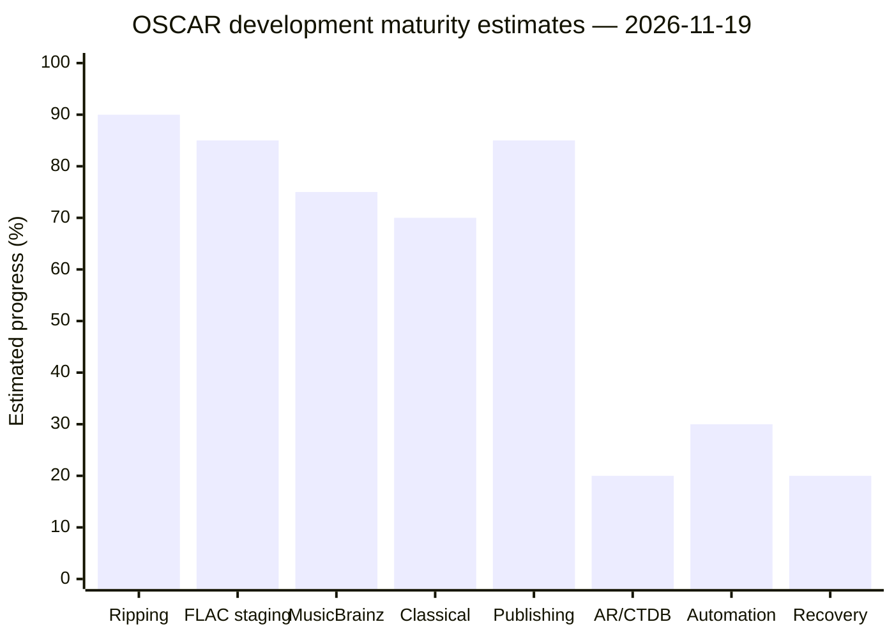

# OSCAR — Development progress dashboard

**Last assessed:** 2026-11-19  
**Assessment type:** qualitative estimates by the project team / ChatGPT, **not measured engineering KPIs**.  
**Canonical status and evidence:** [PROJECT_STATUS.md](PROJECT_STATUS.md)  
**Architecture:** [ARCHITECTURE.md](ARCHITECTURE.md)

> This dashboard tracks implementation maturity toward the eventual **insert CD → Go** experience. The percentages are subjective progress estimates, not test pass rates, promises or objective milestones. Passing CI does not mean a feature has been accepted on real Unraid hardware. Do not calculate a single overall project completion percentage from these different domains.

## Progress by area

| Area | Progress | Visual progress | Evidence / remaining gaps |
|---|---:|---|---|
| CD ripping on Unraid | **90%** | `█████████░` | Multiple optical drives and successful physical rips; unattended detection and recovery remain |
| FLAC & staging verification | **85%** | `████████▌░` | FLAC decode, SHA-256, CUE and cyanrip evidence; independent verification is separate |
| MusicBrainz & release selection | **75%** | `███████▌░░` | Physical release comparison and reviewed metadata copies work; ambiguity still requires intervention |
| Classical metadata | **70%** | `███████░░░` | Works, performers and multidisc review; further edge cases remain |
| Archive publishing | **85%** | `████████▌░` | Anastacia published and manifest independently checked; source-evidence feature awaits hardware acceptance |
| Independent AccurateRip / CTDB | **20%** | `██░░░░░░░░` | Cyanrip AccurateRip evidence is parsed; no independent full verification engine |
| Automatic end-to-end workflow | **30%** | `███░░░░░░░` | Operator review and manual transitions still required |
| Recovery, resume & cleanup | **20%** | `██░░░░░░░░` | Delayed cleanup, crash recovery and safe resume remain major work |

### Bar chart

This Mermaid chart uses the same baseline estimates as the table above (scale 0–100). The table is the accessible fallback when a GitHub client does not render Mermaid charts.

## How to update this living dashboard

1. **At every meaningful feature PR:** review impacted percentages, the supporting evidence and remaining gaps alongside [PROJECT_STATUS.md](PROJECT_STATUS.md). A PR should link both documents when it changes a roadmap domain.
2. Update **the table, text bars, Mermaid chart and date together**. If estimates do not change, explicitly record *reviewed, no percentage change* in the PR summary rather than raising numbers just because code merged.
3. Only count **Unraid hardware acceptance** when it was actually completed; differentiate *implemented*, *CI passed*, *Docker image built*, *hardware tested* and *operationally proven*.
4. Require a brief explanation when an estimate changes (new verified behavior, reduced risk, regression or changed scope). Percentages may go **down** when new gaps are discovered.
5. Do not treat this as an automatic performance gauge. Until metrics are instrumented, **values are editorial judgments**, maintained with code/documentation changes rather than dynamically derived from CI.
6. Never confuse a successful `flac -t` or a cyanrip log claim with an **independent AccurateRip/CTDB verification**.

## Assessment log

| Date | Change | Evidence |
|---|---|---|
| 2026-11-19 | Initial baseline: 90 / 85 / 75 / 70 / 85 / 20 / 30 / 20 | Physical multi-drive tests, verified Anastacia archive publishing (PR #50), source evidence preservation (PR #51, CI-tested), read-only archive auditor (PR #52, CI-tested), documented in [PROJECT_STATUS.md](PROJECT_STATUS.md) |

## Development priorities

- Test PR #51 embedded extraction evidence and PR #52 read-only auditor on real Unraid.
- Add archive audit results to the web UI without overstating verification.
- Investigate independent AccurateRip/CTDB checks and source confidence.
- Build resumable workflow orchestration and safe, evidence-based automatic progression.
- Allow conservative, explicit cleanup only after proven archival integrity.

*This is a planning aid, not a substitute for releases, CI logs, actual test reports or documented source evidence.*
