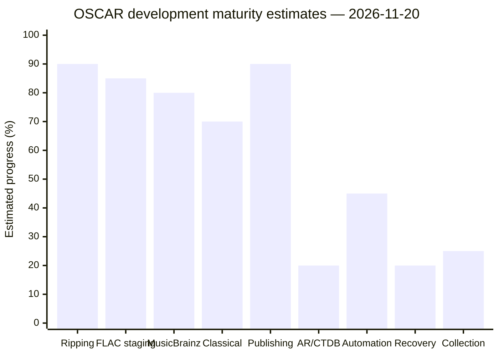

# OSCAR — Development progress dashboard

**Last assessed:** 2026-11-20  
**Assessment type:** qualitative estimates by the project team / ChatGPT, **not measured engineering KPIs**.  
**Canonical status and evidence:** [PROJECT_STATUS.md](PROJECT_STATUS.md)  
**Architecture:** [ARCHITECTURE.md](ARCHITECTURE.md)

> This dashboard tracks implementation maturity toward the eventual **insert CD → Go** experience. The percentages are subjective progress estimates, not test pass rates, promises or objective milestones. Passing CI does not mean a feature has been accepted on real Unraid hardware. Do not calculate a single overall project completion percentage from these different domains.

## Open-source beginner onboarding — draft only (2026-11-20)

Created an explicitly **unreviewed** commented Unraid/Portainer Compose example: [`compose.unraid.example.yml`](../compose.unraid.example.yml). It is a documentation baseline, **not** a tested/recommended replacement for the operator's existing working stack. Required next steps: review exact Docker/Portainer compatibility, network/access controls, mounting and permissions, drives, token handling, archive revision opt-in and safe defaults. **Planned:** [`docs/GETTING_STARTED.md`](GETTING_STARTED.md) (not yet written), a true beginner guide to Docker concepts, prerequisite checks, selecting bridge vs br0 networking, secure secrets, first rip, first archive publish, maintenance, updates and troubleshooting. See [PROJECT_STATUS.md](PROJECT_STATUS.md) for the full checklist. No maturity percentage increase for an untested documentation draft.

---

## Operator-reviewed archive metadata revision (2026-11-20; PR #95 merged, Unraid acceptance pending)

PR #95 was merged into main after successful GitHub Python Tests and Docker build; it implements a separately enabled, **staging-independent** archive migration for one CD leaf at a time: preview all accepted proposals, explicitly confirm, create and verify a new tagged generation, preserve untouched original under hidden `.oscar-archive-versions`, update catalog-based folder naming and Collection SQLite row, and journal the transaction with an explicit recovery pathway. Applies only verified proposed values; `applied` history is distinct from approval. The bulk scanner now discovers published manifest paths directly rather than relying only on an indexed Collection row. Multidisc/boxset migration is blocked and remains a future milestone. Real Unraid validation and integration tests with actual FLACs remain necessary. No maturity percentage increase yet.

---

## Bulk archive scanner and Discogs PAT variable (2026-11-20)

PR #94 (merged after GitHub Tests and Docker CI) implements asynchronous **whole published archive** MusicBrainz scans with per-album progress/error isolation. One-album scans move to Advanced; the legacy Collection label-enrichment tool remains in Advanced because it serves a different read-only-external/write-local-Collection task. Discogs connection renamed to `OSCAR_DISCOGS_PAT`; Unraid Portainer environment must be updated at deployment. The MusicBrainz release UUID was already in FLAC `MUSICBRAINZ_ALBUMID`. No real-Unraid archive metadata migration has yet been performed; PR #95 added the opt-in implementation. Maturity estimates remain unchanged pending real Unraid acceptance.

---

## Unraid archive metadata decision history acceptance (2026-11-20)

The operator demonstrated five SQLite history events on Unraid: Carmen Gomes `CGi2010` accepted, CFMusic ignored → reopened → accepted, and Anastacia Daylight/Epic accepted. The review-decision history now has real-world acceptance evidence; same-value suppression after a rescan and restart persistence remain pending. A small UI fix hides **Reopen decision** on superseded historical entries and requires the actual current accepted/ignored status. No FLAC/manifest/Collection metadata migration is yet implemented. Qualitative progress percentages remain unchanged.

---

## Reversible archive decisions / catalog naming migration (2026-11-20)

Feature branch adds **Reopen decision** for the operator's accidentally ignored CFMusic label on Carmen Gomes Inc. *Desire*; old Ignore is retained as an immutable historical event and the exact proposal can be accepted after reopening. An accepted catalog number `CGi2010` is still **approval only**. Future archive metadata migration is explicitly required to update the album folder from `Desire (2010) [fa89edc1]` to `[CGi2010] Desire (2010) [fa89edc1]`, with verified safety/rollback and catalog path reconciliation. No file rename in this feature. CI + real Unraid acceptance pending; progress percentages unchanged.

---

## First real Unraid archive-scanner result (2026-11-20)

OSCAR's Collection UI displayed four selectable published leaves: Anastacia, Carmen Gomes Inc., and Boulez/Stravinsky discs 4/6 and 6/6. A Carmen Gomes scan found **2 differences** (missing `CGi2010` catalog number and `CFMusic` label); the **global pending queue showed 3 proposals**, including a previously observed Anastacia label addition (`Daylight`, `Epic`). This confirms archive scanning and pending-proposal display on real Unraid. It does **not** yet verify durable Accept/Ignore suppression after rescans or container restart, nor actual archive metadata application. Keep existing qualitative percentages unchanged.

---

## Archive metadata scanner — PR #89 merged, Unraid acceptance pending (2026-11-20)

Collection receives staging-independent read-only **Scan archive for metadata additions** and **Scan archive for metadata changes** plus persistent Accept/Ignore proposals and history. Validates published FLAC hashes, queries exact MusicBrainz CD medium and stores non-destructive proposals in `catalog.sqlite3`. Accept is approval for a separate future migration, **not an applied FLAC update**. GitHub Tests and Docker CI passed before merge (commit `f25e374`). No percentage increase before real Unraid acceptance. See [ARCHIVE_METADATA_LIFECYCLE.md](ARCHIVE_METADATA_LIFECYCLE.md).

---

## Archive-first metadata maintenance — design only (2026-11-20)

Future Collection actions: **Scan archive for metadata additions** and **Scan archive for metadata changes**, independent of temporary staging. Persist specific Accept/Ignore decisions; identical proposals stay suppressed, while genuinely new provider values or archive revisions can produce fresh proposals. Preserve immutable ripping evidence and archive history; only a separate audited, operator-approved archive-version migration may modify released metadata. See [ARCHIVE_METADATA_LIFECYCLE.md](ARCHIVE_METADATA_LIFECYCLE.md).

**No maturity-percentage increase:** implementation and real Unraid acceptance are still pending.

---

## Real Unraid acceptance — newly tagged staging copy (2026-11-20)

**PR #84 reprocessing accepted on operator's Unraid deployment:** newly generated Carmen Gomes Inc. *Desire* copy `cd2959e6cc2b4c4ab6fafb590808b2db` is `tagged_copy_ready_for_review`; inspecting actual FLAC tags and hashes gives `tags_match_preview` for all **12 tracks**. No archive publication occurred, and the original published archive is reported unchanged. This follows the confirmed read-only comparison detecting the corrected MusicBrainz catalog `CGi2010`. **Archival migration and Collection reconciliation are not implemented or verified yet.** Qualitative dashboard percentages remain unchanged until larger-sample validation.

---

## Collection catalog recovery and missing catalog warning (2026-11-20)

The operator observed `ARCHIVE_PUBLISHED · catalog: indexed` for *Carmen Gomes Inc. — Desire*, but Collection still reported three records and zero imports. The code fix accepts valid archive folders without a printed catalog prefix and confirms the SQLite row exists before reporting `indexed`. Additionally, future physical-CD archive reviews flag a missing MusicBrainz catalog number for explicit acknowledgment instead of silently omitting it. No numbers are invented, and existing audio, manifests and archive names are not changed.

**Validation status:** implementation on test branch; GitHub CI and real Unraid Collection re-import remain acceptance gates. Existing dashboard percentages remain unchanged.

---

## Latest engineering change — MusicBrainz match refresh (2026-11-20)

PR #79 merged to `main` after passing GitHub Tests and Docker build (commit `ca0239a`); Unraid acceptance for read-only refresh confirmed by operator on Carmen Gomes Inc. *Desire* job. Implemented: operator-triggered, authenticated read-only refresh of an accepted MusicBrainz release's current Disc ID medium association. The saved TOC, disc ID, and completed verification are checked before the network lookup. Historical `INFERRED_OPERATOR_ACCEPTED` is never upgraded, and no audio, tagging, or archive operation is triggered. See [MUSICBRAINZ_MATCH_REFRESH.md](MUSICBRAINZ_MATCH_REFRESH.md) and [PROJECT_STATUS.md](PROJECT_STATUS.md).

**The operator's Unraid GUI now confirms the saved Disc ID is attached on medium 1 of the accepted release, while preserving the original inferred-approval status.** Percentages remain unchanged because this validates one bounded feature, not fully automatic release certainty or independent pressing identification.

Branding foundation #78 is merged to main; image binary integration and Unraid visual acceptance remain outstanding.

---

## Current development — safe MusicBrainz metadata refresh / restaging (2026-11-20)

PR #84 has been merged to main after successful GitHub Tests and Docker build (commit `c5625a7`). The new implementation adds read-only comparison between fresh MusicBrainz metadata and the accepted prior tagged copy; after explicit operator confirmation it may create a new verified-copy staging job **without changing the already published archive or the original durable workflow**. The Carmen Gomes catalog correction has not yet been confirmed live on Unraid. All GitHub Tests + Docker build must pass before merge; user hardware acceptance follows. See [METADATA_REPROCESS.md](METADATA_REPROCESS.md) and [PROJECT_STATUS.md](PROJECT_STATUS.md).

**Maturity percentages remain unchanged** pending repeatable tests and operator-confirmed deployment. Archive replacement/migration is not part of this feature.

---

## Unraid acceptance — MusicBrainz catalog correction observed (2026-11-20)

The operator tested PR #84 against existing Carmen Gomes Inc. *Desire* and saw the current MusicBrainz release return catalog `CGi2010`, absent in the original saved metadata. OSCAR correctly displayed 14 changes: one album catalog field, one CFMusic label catalog field, and the 12 proposed CATALOGNUMBER track tags. **Read-only comparison accepted on real Unraid.** A separate newly tagged staging copy has **not** yet been reported verified, and archive/Collection migration remains future work. Do not inflate domain maturity percentages based on the preview alone.

---

## Progress by area

| Area | Progress | Visual progress | Evidence / remaining gaps |
|---|---:|---|---|
| CD ripping on Unraid | **90%** | `█████████░` | Multiple optical drives and successful physical rips; unattended detection and recovery remain |
| FLAC & staging verification | **85%** | `████████▌░` | FLAC decode, SHA-256, CUE and cyanrip evidence; independent verification is separate |
| MusicBrainz & release selection | **80%** | `████████░░` | Boulez multi-disc media 4/6 and 6/6 archived; operator-accepted single-CD missing Disc ID fallback and user-controlled MusicBrainz TOC attach handoff (#74–#76); fresh read-only Disc ID match refresh accepted on real Unraid Carmen Gomes job (#79); unattended edition certainty remains |
| Classical metadata | **70%** | `███████░░░` | Works, performers and multidisc review; further edge cases remain |
| Archive publishing | **90%** | `█████████░` | Anastacia and Boulez discs 4 and 6 independently published_verified in Collection and confirmed as separate folders inside same physical boxset on Unraid; recovery, additional releases and full audit remain |
| Independent AccurateRip / CTDB | **20%** | `██░░░░░░░░` | Cyanrip AccurateRip evidence is parsed; no independent full verification engine |
| Automatic end-to-end workflow | **45%** | `████▌░░░░░` | Three-mode Go! workflow with durable release acceptance, isolated tagged copies and human-approved archive publish demonstrated; still user-advanced, no automatic CD insertion/fully unattended orchestration |
| Recovery, resume & cleanup | **20%** | `██░░░░░░░░` | Delayed cleanup, crash recovery and safe resume remain major work |
| Local & multi-platform collection management | **25%** | `██▌░░░░░░░` | Local published-archive catalog, export, Discogs read-only PAK discovery in code; MusicBrainz OAuth and collection sync not yet implemented |

### Bar chart

This Mermaid chart uses the same baseline estimates as the table above (scale 0–100). The table is the accessible fallback when a GitHub client does not render Mermaid charts.

## How to update this living dashboard

1. **At every meaningful feature PR:** review impacted percentages, the supporting evidence and remaining gaps alongside [PROJECT_STATUS.md](PROJECT_STATUS.md). A PR should link both documents when it changes a roadmap domain.
2. Update **the table, text bars, Mermaid chart and date together**. If estimates do not change, explicitly record *reviewed, no percentage change* in the PR summary rather than raising numbers just because code merged.
3. Only count **Unraid hardware acceptance** when it was actually completed; differentiate *implemented*, *CI passed*, *Docker image built*, *hardware tested* and *operationally proven*.
4. Require a brief explanation when an estimate changes (new verified behavior, reduced risk, regression or changed scope). Percentages may go **down** when new gaps are discovered.
5. Do not treat this as an automatic performance gauge. Until metrics are instrumented, **values are editorial judgments**, maintained with code/documentation changes rather than dynamically derived from CI.
6. Never confuse a successful `flac -t` or a cyanrip log claim with an **independent AccurateRip/CTDB verification**.

## Assessment log

| Date | Change | Evidence |
|---|---|---|
| 2026-11-20 | Reassessed MusicBrainz 75 → 80, archive 85 → 90, Go! automation 30 → 45; added separate collection-management 25. These are **subjective** domain maturity estimates, not completion or CI coverage. | Real Unraid: Boulez CD 4 and CD 6 both `published_verified`, separate `Disc 04`/`Disc 06` folders under one boxset; Disc ID of Carmen Gomes *Desire* attached to MusicBrainz via human-confirmed handoff; #74–#76 merged/tested. MusicBrainz OAuth, automated insertion, error recovery still not built. |

| Date | Change | Evidence |
|---|---|---|
| 2026-11-19 | Reassessed after PR #58 configuration UI (Best Guess / three Secure review levels); no percentage change because execution policies and unattended orchestration remain future work. | Settings migration/validation tests and [PROJECT_STATUS.md](PROJECT_STATUS.md) |
| 2026-11-19 | Reassessed after risk-based physical edition candidate UI; percentages unchanged pending Unraid testing and server-enforced approval evidence. | Unique candidates inspected read-only; ambiguous candidates prompt for catalog; see [PROJECT_STATUS.md](PROJECT_STATUS.md) |
| 2026-11-19 | Reassessed; no percentage change. PR #52's archive-audit CLI ran on real Unraid: 1 album, 12 FLACs, PASS_WITH_WARNINGS (expected EVIDENCE_NOT_EMBEDDED). Source-evidence embedding from PR #51 and independent CTDB are still untested. | User's terminal output of `docker exec oscar python -m oscar.archive_audit /archive`; [PROJECT_STATUS.md](PROJECT_STATUS.md) |
| 2026-11-19 | Initial baseline: 90 / 85 / 75 / 70 / 85 / 20 / 30 / 20 | Physical multi-drive tests, verified Anastacia archive publishing (PR #50), source evidence preservation (PR #51, CI-tested), read-only archive auditor (PR #52, CI-tested), documented in [PROJECT_STATUS.md](PROJECT_STATUS.md) |

## Soloist metadata classification correction — PR #65

Real OSCAR Collection Library feedback exposed broad session performers incorrectly classified as soloists on pop albums. Fixed by preserving full source performer credits and limiting classical soloist display to explicitly tagged classical albums with soloist-marked contributor roles. Re-import can repair old automatically derived fields without changing archives. No change to Go controller or project progress percentages.

## Go! executable phase one — PR #64

Automatic durable job creation at rip start, verification callback and read-only release candidate discovery have been added with a single Go! interface. No automatic tagged-copy or final archive publication yet. **Keep the maturity estimates unchanged** pending GitHub checks, real Unraid physical acceptance and end-to-end safe tagged-copy/publish orchestration. Next priority: verified release resolver and explicit policy enforcement.

## Persistent workflow ledger toward Go! (PR #63)

A durable per-rip phase/event ledger with user mode snapshot and safe review deferral has been implemented as a **manually registered foundation**. It is not yet an automatic scheduler, and cannot restart an interrupted rip or auto-tag/archive. Maintain the eight qualitative percentages pending real Unraid acceptance and an executing state machine.

## Track-level collection evidence + Go! roadmap (PR #62)

Source-backed track/credit/Work indexes and a strictly exact-release+catalog MusicBrainz label-backfill action have been added to the collection workflow. **No completion-percentage increase yet:** CI and actual Unraid verification are separate; a persistent per-disc controller and safe metadata decision engine are not implemented. The next development priority is [AUTOMATION_ROADMAP.md](AUTOMATION_ROADMAP.md), not continued collection UI polish.

## Nextcloud-compatible exports and classical album discovery (PR #61)

Adds XLSX download plus read-only album-level search/sort by label and classical performers; safe in-place SQLite migration, and explicit label evidence recorded in *future* publication manifests. Track-level classical Work/Soloist tables, independent backfill of old label metadata and remote Discogs collection writes are still missing. Do **not** inflate existing percentages until CI, actual Unraid import and Nextcloud editor checks.

## Phase 1 collection catalog progress (PR #60)

Local database of OSCAR published archives, ODS/CSV export, sortable UI, read-only Discogs PAK identity/folder access and fixed metadata rip attribution are implemented in code. These do not yet provide a comprehensive physical ownership database, remote collection write, edition matching or automatic workflow. Keep all existing qualitative percentages unchanged pending CI and real Unraid acceptance.

## Proposed collection management extension

[Discogs and OSCAR local catalog design](DISCOGS_COLLECTION_CATALOG.md) covers secondary physical-edition discovery, optional collection sync, condition/sleeve/notes/folder entry, per-copy identity and sortable **ODS-first** export. **Design only: no implementation or progress-percentage change** until concrete features and tests exist. The initial eight baseline maturity estimates remain unchanged for that earlier design-only proposal; collection management is now tracked separately.

## Current functional boundaries (2026-11-20)

- **Proven on Unraid:** reviewed archive publication of Anastacia and two discs of Boulez 6-CD boxset; Collection records three individual published discs. `published_verified` is an archive/audio state, **not** independent proof of the exact pressing.
- **Disc ID workflow:** original libdiscid TOC is saved and MusicBrainz's official attach page is offered with accepted release prefilter (#75–#76). Carmen Gomes's 12-track physical Disc ID `VxfLacbEsNFCv5Ua4bvIeBIQ3jQ-` is now linked to MB release `fa89edc1-32f9-4290-8788-bbac2e366a46` by the user. Its older OSCAR workflow may still show `INFERRED_OPERATOR_ACCEPTED`; fresh lookup and persistent evidence reconciliation are a next task.
- **MusicBrainz collection OAuth:** **planned, not implemented**. Proposed environment names `OSCAR_MUSICBRAINZ_ID` (client ID) and `OSCAR_MUSICBRAINZ_CS` (client secret), not `..._CI` or `..._CLIENT_ID`. An OAuth registered application/secret does not itself mean OSCAR can connect yet. Discogs uses `OSCAR_DISCOGS_PAK`.
- **Edit notes:** manual user confirmation on MusicBrainz is still required; deterministic, factual, English edit-note template and copy-to-clipboard are **planned in OSCAR**, without a paid AI dependency.
- **Collection sync:** external MusicBrainz and Discogs inventory comparison, read-only OAuth collection fetch, idempotent opt-in writes and physical-copy vs boxset distinction remain **planned**. Local published archive catalog is already implemented.

## Development priorities

1. Fresh MusicBrainz Disc ID match refresh for already accepted jobs, without misrepresenting earlier inference as physical verification.
2. Deterministic edit-note generator and copy UX for MusicBrainz submissions; never invent evidence.
3. MusicBrainz OAuth connection (secure server-side secret/token handling, CSRF `state`, redirect URI, collection scope) using `OSCAR_MUSICBRAINZ_ID` and `OSCAR_MUSICBRAINZ_CS`; first read-only collection listing.
4. OSCAR × Discogs × MusicBrainz read-only collection comparisons before any opt-in writes; account-specific collection semantics and multiple owned copies must be preserved.

- Test PR #51 embedded extraction evidence in a *new* archive publication; PR #52's initial read-only audit has now passed on real Unraid for Anastacia.
- Add archive audit results to the web UI without overstating verification.
- Investigate independent AccurateRip/CTDB checks and source confidence.
- Build resumable workflow orchestration and safe, evidence-based automatic progression.
- Allow conservative, explicit cleanup only after proven archival integrity.

*This is a planning aid, not a substitute for releases, CI logs, actual test reports or documented source evidence.*
